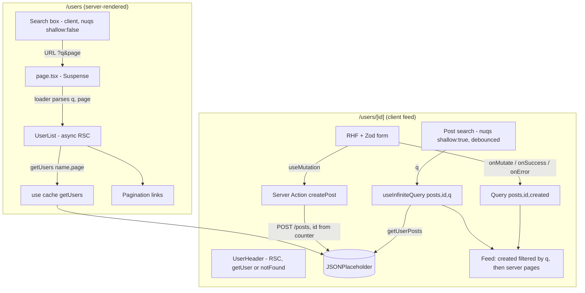
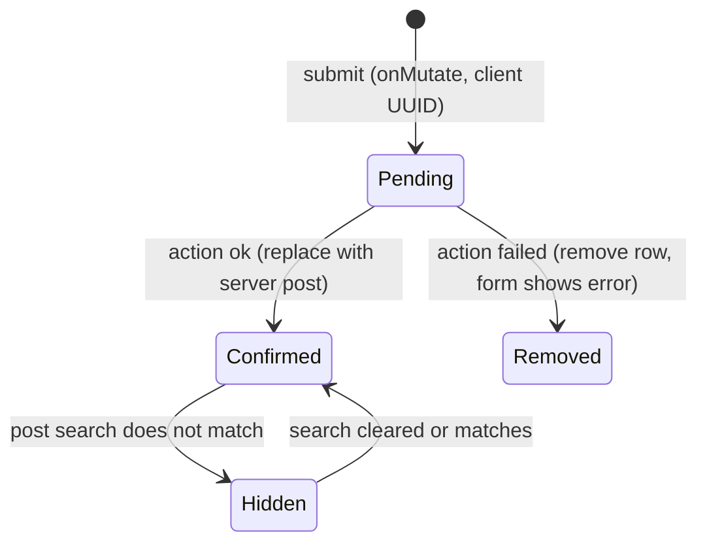

# User Feed Take-Home - Plan

## Goal Capsule

- **Objective:** An evaluator can open a public repo, run the app, search users by name, open a user, scroll through their posts, publish a new post that appears in the list, and see loading and error states. Client components are backed by automated tests, and the server-rendered list is checked manually on a production build. A README that explains the decisions, and a commit history that shows how the work progressed.
- **Means:** A server-rendered user list driven by URL state (KTD1) and a client-cached infinite posts feed (KTD2), on JSONPlaceholder.
- **Authority:** `_local_context/task.md` (the brief) wins on product behavior. The Requirements below win over this plan's units. KTDs win on mechanism.
- **Priority order:** Brief requirements first (U1–U5, then U8). Decoration (U7) comes after the brief is met, and adds one README line if it ships.
- **Execution profile:** One branch with one conventional commit per unit, at minimum. The brief rejects a single commit. Delivery is a public GitHub repo within 48 hours of the brief.
- **Stop conditions:** Stop and ask if JSONPlaceholder changes behavior from what is recorded in the API reference below, or if a settled KTD proves unworkable.
- **Who finishes:** The user (repo owner) publishes the repo and sends the link. Playwright e2e lives in a separate worktree and is not part of this plan.

---

## Product Contract

### Summary

Two routes on JSONPlaceholder.

- `/users` is a server-rendered, URL-driven list: 5 users per page, name search, user cards.
- `/users/[id]` shows the user header and a client-side infinite feed of their posts, with a search box and a validated create form whose new posts appear at the top.

Tests cover the client components. The README records decisions, the API quirks, and how AI was used.

### Problem Frame

The brief is a 48-hour take-home whose functional surface is small: list, search, detail, create. With a surface that small, judgment is the differentiator. Each data strategy must have a reason a reviewer accepts.

- The user list is shareable, bookmarkable state, so it lives in the URL and renders on the server.
- The posts list must hold posts the API never saves, so it lives in a client cache.

JSONPlaceholder has undocumented behavior that a careless build gets wrong: regex filters that return 500, a full-text `q` that matches ids, and a POST that always answers `id: 101`. The plan treats those as requirements.

### Requirements

**User list**

- R1. `/users` lists users 5 per page, with page navigation and a visible total.
- R2. A search box filters users by name only, case-insensitive. Any typed character, including regex metacharacters, is safe.
- R3. Search and page live in the URL. A shared or reloaded URL shows the same results. Changing the search returns to page 1.
- R4. An invalid page value falls back to page 1. A page beyond the last page redirects to the last page.
- R5. Each user is a card showing name, username, email and company, and links to the user's posts.

**User posts**

- R6. `/users/[id]` shows the user's header. An unknown user shows a not-found page.
- R7. The user's posts load in pages of 4 as the reader scrolls. A "Load more" button does the same for keyboard users and when the observer is unavailable. The end of the list is stated.
- R8. A search box filters the user's posts through the API's `q`. The term lives in the URL without a server round-trip, and changing it restarts the feed from the beginning.

**Create post**

- R9. A form with required title and body validates on the client and on the server. Errors show inline next to each field.
- R10. Submitting adds the post at the top of the feed immediately, and the post persists while the reader stays in the app session. A failure removes it and shows the error.
- R11. The form cannot be double-submitted and resets after success.

**States**

- R12. Every data region has a visible loading state, an error state with retry, and an empty state. Empty states differ between "no data" and "no matches".

**Delivery**

- R13. At least 3 Vitest + Testing Library tests pass.
- R14. The README covers how to run the app, the decisions, what would be done with more time, how AI was used (what was asked, accepted and corrected), and the API quirks behind KTD3 and KTD4.
- R15. Commits land incrementally, one or more per unit.

### Acceptance Examples

- AE1. Covers R2. Given the search "an", when results load, then only "Leanne Graham" shows, not users whose email or company contains "an".
- AE2. Covers R2. Given the search "(", when results load, then the empty state shows and no server error occurs.
- AE3. Covers R3, R4. Given `/users?page=2`, when the reader types "cle", then the URL becomes `?q=cle` with no page param, and results show page 1.
- AE4. Covers R4. Given `/users?page=9`, the reader lands on `/users?page=2`. Given `?page=abc`, page 1 renders.
- AE5. Covers R8, R10. Given a created post titled "Hello", when the reader searches "zzz", the created post is hidden. Clearing the search shows it again at the top.
- AE6. Covers R8. Given user 1's posts and the search "1", all 10 posts match, because `q` also matches `id` and `userId` by substring. Other users get partial id matches; user 2 gets 9. This is accepted and documented in the README (KTD4).

### Key Decisions

- **Two data strategies, each justified by what the data needs.** Server and URL state for the list, a client cache for the feed (session-settled: user-directed — chosen over a single strategy for both routes: shows range only when each choice has a stated reason). Governs R3, R8, R10.
- **The user list is paginated at 5 per page.** Pagination shows URL state and server rendering even on a 10-user dataset (session-settled: user-directed — chosen over a single unpaginated list: the user asked for 5-per-page pagination explicitly). Governs R1, R3, R4.
- **New posts appear optimistically and roll back on failure.** (session-settled: user-approved — chosen over appending only after the action resolves: proposed with that trade-off in the scope confirmation, and accepted). Governs R10.
- **Brief first, decoration later.** Hashed avatars (U7) and anything beyond the brief come after R1–R15 are met (session-settled: user-directed — chosen over building decoration alongside: the brief is what is graded). Governs R5.

### Scope Boundaries

- Tests cover client-rendered components only. Async Server Components are covered by Playwright in a separate worktree.
- Real persistence, editing and deleting posts, comments, auth and sorting are out. The API supports `_sort`; the brief does not ask for it.
- Considered and not built: a newest-wins mutation queue or a server version check for created posts. One tab and one in-memory counter cannot produce conflicting writes worth guarding. Two concurrent editors of the same post would change that.
- Considered and not built: clamping post search to title and body only on the server. `q` matches ids by design (KTD4), and a regex filter cannot express title OR body.

#### Deferred to Follow-Up Work

- Fake post population, so each user's feed has enough posts to feel like a real feed. It plugs into the `getUserPosts` seam (KTD7) without UI changes.
- Playwright e2e for both routes (separate worktree).

### API Reference (verified 2026-11-15 by live requests)

JSONPlaceholder runs json-server 0.x. Its guide documents only the basic routes, so these behaviors come from json-server 0.x and were confirmed against the live API.

| Behavior                  | Observed                                                                                                                         |
| ------------------------- | -------------------------------------------------------------------------------------------------------------------------------- |
| `_page`, `_limit`         | Returns `X-Total-Count` and `Link`, exposed to CORS. The header appears only when `_page` is sent.                               |
| Users total               | 10 users, so 2 pages of 5.                                                                                                       |
| Posts                     | Exactly 10 per user, 100 in total. `/users/:id/posts` is equivalent to `/posts?userId=:id`.                                      |
| `name_like`, `title_like` | Case-insensitive regex. An invalid pattern (`(`) returns HTTP 500. Several `_like` params are combined with AND.                 |
| `q`                       | Full-text over every field, including `id` and `userId`. `q=1` on user 1's posts returns all 10, and user 3's returns 1 (id 21). |
| Unknown params            | Ignored.                                                                                                                         |
| Not found                 | `/users/999` returns 404. `/users/999/posts` returns 200 `[]`.                                                                   |
| `POST /posts`             | Nothing is saved. Always responds `{...body, id: 101}`.                                                                          |
| Caching                   | `cache-control: max-age=43200` on reads.                                                                                         |

---

## Planning Contract

### Key Technical Decisions

- KTD1. **Users list: Server Component reading nuqs-parsed search params, fetching through `"use cache"` functions keyed by `(name, page)`.** A client search box writes the URL with `shallow: false`, `limitUrlUpdates: debounce(…)` and `startTransition` (`throttleMs` is deprecated; nuqs `^2.10.3` or later, since 2.9.0 fixed a stale-URL bug under Cache Components), and the list dims while pending (session-settled: user-directed — chosen over client fetching for the list: shareable URL state and server rendering). Pattern: `/data/Personal/ecommerce-base/apps/backoffice/src/features/access-management/users/search-params.ts` (`createLoader`, custom positive-page parser, serializer) and `users/list/table/users-table.tsx` (`useQueryStates` with `shallow:false, startTransition`). Under Cache Components, the `searchParams` read sits inside `<Suspense>` and parsed values pass as arguments to the cached function, as in `/data/Personal/archived/nextjs-references/next-books/app/page.tsx`. Use `cacheLife("hours")`: the data never changes, and a past-revalidate entry blocks dynamic renders. Every component that calls a nuqs hook (UsersSearch, PostsSearch, and whatever reads `q` for the feed) sits inside `<Suspense>`. So does the `/users/[id]` `params` read: the page passes the `params` promise down instead of awaiting it at the top. Otherwise `pnpm build` fails under Cache Components.
- KTD2. **Posts feed: `useInfiniteQuery` in the browser, fetching JSONPlaceholder directly.** The query key is `["posts", userId, { q }]`, the page param is the page number, and `getNextPageParam` derives from `X-Total-Count` (session-settled: user-directed — chosen over server-rendered pages or a `?page=N` URL-driven feed: shows client cache ownership, which created posts need). Only the user header is server-rendered. Server prefetch plus `HydrationBoundary` is not used: under Cache Components it needs the custom hydration stamp from `next16-team-chat/lib/dehydrate.ts`, which costs more than it gains here.
- KTD3. **User search uses `name_like` with the input regex-escaped.** One pure `escapeRegExp` helper is unit-tested (session-settled: user-approved — chosen over `q`: `q` matches email, company and id, which breaks "search by name"; see AE1 and AE2).
- KTD4. **Post search uses `q`, with its id false-positives documented in the README** (session-settled: user-directed — chosen over `title_like`: covers title and body and needs no escaping; the brief sets no post-search rule). Created posts are filtered on the client with a case-insensitive substring match on title or body, never ids.
- KTD5. **Create post is a Server Action called from `useMutation`.** It validates with the shared Zod schema, awaits `POST /posts`, and returns `{ ok: true, post }` with `id` taken from a module-level counter starting at 101, or `{ ok: false, error }`. It never throws, because thrown messages are stripped in production (session-settled: user-directed — chosen over a client-side POST: keeps the API call and id generation on the server). The counter resets on restart and is per instance. The README says so.
- KTD6. **Created posts live in their own per-user query entry, `["posts", userId, "created"]`, never inside the infinite pages.** That entry has `staleTime` and `gcTime` set to `Infinity`. Rows are keyed by a client UUID. A refetch, a search change or a gcTime eviction of the infinite query would drop prepended rows, and the server counter can repeat ids after a restart. The created entry is kept newest-first. Optimistic flow: `onMutate` prepends a pending row with `setQueryData` and cancels nothing, because the created entry is never fetched and cancelling the infinite query would strand its first or next page. `onSuccess` replaces the pending row with the server post. `onError` removes it and maps the error to the form.
- KTD7. **One data-access seam per resource.** `getUsers`, `getUser` and `getUserPosts` live in feature `api` modules and return typed, Zod-parsed results. `getUsers` and `getUserPosts` also return `total`. The UI never builds JSONPlaceholder URLs. `POSTS_PAGE_SIZE = 4` is a named constant there. The deferred fake population replaces the `getUserPosts` body only.
- KTD8. **Errors.** Route-level `error.tsx` uses `retry()`, which became stable in Next 16.3; `reset()` does not refetch Server Component data. Feed errors render inline with a retry button. A failed next page keeps the loaded pages and stops auto-loading until the reader retries.
- KTD9. **UI from shadcn (`base-luma`, Base UI) only:** card, empty, skeleton, field, input, input-group, textarea, alert, avatar, pagination, spinner, toast, badge. Use the Base UI `toast` (`<Toaster />` plus `toast.add`), not `sonner`, per the local shadcn rules for Base UI. Do not install `form`: in base-luma it is an empty stub. The form uses `FieldGroup` + `Field` with RHF `Controller` and `zodResolver`, per `.agents/skills/shadcn/rules/forms.md`. Never call `watch()`: the repo's `react-hooks/incompatible-library` warning fails lint at max-warnings 0. Use `useWatch` when a value is needed. The search box uses `InputGroup` with `InputGroupInput` and a search-icon addon. Install components into `packages/ui` with the shadcn CLI. Do not hand-write them.
- KTD10. **Tests: Vitest with jsdom, `@vitejs/plugin-react` and Testing Library, in `apps/web` only.**
  - Server Action modules are replaced with `vi.mock`.
  - `fetch` is stubbed per test with `vi.stubGlobal`. No MSW: one `fetch` call site per resource makes a stub enough.
  - nuqs uses its testing adapter, with assertions on URL updates.
  - `IntersectionObserver` is not polyfilled. Tests drive the "Load more" button (R7).
  - ecommerce-base has no frontend test setup to copy, so this setup is new.
- KTD11. **Page param:** a custom parser accepts only positive integers and falls back to 1, following the backoffice `positivePage` parser. An out-of-range page `redirect()`s to the last page once the total is known. Zero results render the empty state on page 1.

### High-Level Technical Design

Data flow across both routes:



Created-post lifecycle (KTD6):



### Output Structure

```text
apps/web/
  app/
    page.tsx                      redirect to /users
    providers.tsx                 NuqsAdapter, QueryClientProvider, Toaster (Base UI toast)
    users/
      page.tsx                    list route
      error.tsx                   retry()
      [id]/
        page.tsx                  header + feed
        not-found.tsx
        error.tsx
  features/
    users/
      api.ts                      getUsers, getUser ("use cache")
      schemas.ts
      search-params.ts            nuqs parsers + loader + serializer
      components/                 user-list, user-card, users-search, users-pagination, skeletons
      utils/hash.ts               (U7)
      components/user-avatar.tsx  (U7)
    posts/
      api.ts                      getUserPosts, POSTS_PAGE_SIZE
      schemas.ts                  post + create-post schemas
      actions.ts                  "use server" createPost
      hooks/                      use-posts-feed, use-create-post
      components/                 posts-feed, post-card, posts-search, create-post-form, skeletons
  lib/
    jsonplaceholder.ts            base URL, fetch + total helper
    escape-regexp.ts
    query-client.ts
  tests/
    setup.ts
    *.test.tsx
  vitest.config.ts
```

---

## Implementation Units

### U1. Foundations: dependencies, shadcn components, providers, test harness

- **Goal:** Everything later units import exists, and one smoke test runs.
- **Requirements:** R13 (enabler), R12 (toast, skeleton).
- **Dependencies:** none.
- **Files:** `apps/web/package.json`, `packages/ui/package.json`, `packages/ui/src/components/*` (installed via the CLI), `apps/web/app/providers.tsx`, `apps/web/app/layout.tsx`, `apps/web/app/page.tsx`, `apps/web/lib/query-client.ts`, `apps/web/vitest.config.ts`, `apps/web/tests/setup.ts`, `apps/web/tests/smoke.test.tsx`, `turbo.json` (test task), root `package.json` (test script).
- **Approach:**
  1. Add `nuqs` (`^2.10.3` or later), `@tanstack/react-query`, `react-hook-form`, `@hookform/resolvers` and `zod` to `apps/web`. `zod` must be declared there, because today only `packages/ui` declares it.
  2. Add the dev dependencies `vitest`, `@vitejs/plugin-react`, `jsdom`, `@testing-library/react`, `@testing-library/user-event` and `@testing-library/jest-dom`. Peer constraints to resolve at install time:
     - Vitest 5.x needs `@types/node` `^22` or `>=24`; bump it from `^20`.
     - jsdom 31 needs Node `^22.22.2` or `^24.15`; align `.nvmrc` and `engines`, or pin a lower jsdom.
     - `@vitejs/plugin-react` 6 needs vite 8 and has no `babel` option. Tests do not need the React Compiler.
     - Follow `apps/web/node_modules/next/dist/docs/01-app/02-guides/testing/vitest.md`.
  3. Install the KTD9 components into `packages/ui` with the shadcn CLI.
  4. Add a client `providers.tsx` with `NuqsAdapter` (app router), `QueryClientProvider` and `Toaster`, and wrap it in `layout.tsx` inside `ThemeProvider`. Create the browser QueryClient once with `isServer` guarding.
  5. Replace the scaffold `app/page.tsx` with a redirect to `/users`.
  6. Configure Vitest with jsdom, a `@/` alias and jest-dom matchers, and add `test` scripts to `apps/web`, the root and turbo.
- **Patterns to follow:** `/data/Personal/ecommerce-base/apps/backoffice/src/app/providers.tsx` for adapter nesting.
- **Test scenarios:** A smoke test renders a shadcn `Button` inside the test providers and finds it by role. This proves the alias, jsdom and matchers work.
- **Verification:** `pnpm test`, `pnpm typecheck` and `pnpm lint` pass. Visiting `/` lands on `/users`.

### U2. API layer and schemas

- **Goal:** Typed, Zod-validated access to users and posts behind the KTD7 seams, with the quirks handled once.
- **Requirements:** R1, R2, R6, R7, R8.
- **Dependencies:** U1.
- **Files:** `apps/web/lib/jsonplaceholder.ts`, `apps/web/lib/escape-regexp.ts`, `apps/web/features/users/schemas.ts`, `apps/web/features/users/api.ts`, `apps/web/features/posts/schemas.ts`, `apps/web/features/posts/api.ts`, `apps/web/tests/escape-regexp.test.ts`, `apps/web/tests/posts-api.test.ts`.
- **Approach:**
  - `jsonplaceholder.ts` owns the base URL and a helper that returns parsed JSON plus `X-Total-Count`. Non-2xx responses become typed errors.
  - `getUsers({ name, page })` sends `name_like=escapeRegExp(name)` only when the name is non-empty, plus `_page` and `_limit=5`, and returns `{ users, total, totalPages }`. It is `"use cache"` with `cacheLife("hours")` and plain-value arguments.
  - `getUser(id)` returns `null` on 404.
  - `getUserPosts({ userId, q, page })` is a plain async function, callable from the browser, that uses `POSTS_PAGE_SIZE` and returns `{ posts, nextPage | undefined }`.
  - Schemas parse only the fields the UI renders: user name, username, email, company name and website, and post id, title and body.
- **Test scenarios:**
  - `escapeRegExp("(a.b)*")` returns a string that, used as a RegExp, matches only the literal input.
  - `escapeRegExp("")` returns `""`.
  - `getUserPosts` with a stubbed `fetch` returning 4 posts and `X-Total-Count: 10` for page 1 gives `nextPage: 2`. For page 3 (2 posts) it gives `nextPage: undefined`.
  - `getUserPosts` with `q: "abc"` calls a URL containing `q=abc` and `_limit=4`.
  - A stubbed 500 response rejects with a typed error, not a parse crash.
  - What this seam misses: real API drift. The README's API section is the mitigation.
- **Verification:** Unit tests pass. A manual call of `getUsers({ name: "(", page: 1 })` returns an empty list with no 500.

### U3. Users list route (brief point 1)

- **Goal:** `/users` meets R1–R5 and R12 for the list.
- **Requirements:** R1, R2, R3, R4, R5, R12.
- **Dependencies:** U2.
- **Files:** `apps/web/features/users/search-params.ts`, `apps/web/features/users/components/users-search.tsx`, `apps/web/features/users/components/user-list.tsx`, `apps/web/features/users/components/user-card.tsx`, `apps/web/features/users/components/users-pagination.tsx`, `apps/web/features/users/components/user-list-skeleton.tsx`, `apps/web/app/users/page.tsx`, `apps/web/app/users/error.tsx`, `apps/web/tests/users-search.test.tsx`, `apps/web/tests/user-card.test.tsx`.
- **Approach:**
  1. `search-params.ts` defines `q` (string, default "") and `page` (positive-int parser per KTD11), a server loader, and a serializer for pagination hrefs.
  2. `page.tsx` keeps the shell static and reads `searchParams` inside `<Suspense>` with a skeleton fallback. It passes parsed values to `UserList`.
  3. `UserList` (async RSC) calls `getUsers`. It redirects to the last page when `page > max(totalPages, 1)`, so a zero-result page beyond 1 lands on page 1 (KTD11). Above the cards it shows the total: "{total} users", or "{total} users match \"{q}\"" when a search is active. Cards are one column on mobile and two from the `md` breakpoint. Zero results show `Empty`, with "No users match" when a search is active and "No users" otherwise.
  4. `UsersSearch` (client) uses `useQueryStates` with `shallow: false`, `limitUrlUpdates: debounce(300)` and `startTransition` (KTD1). Typing sets `page` to null. The pending state marks a wrapper that dims the list.
  5. `UserCard` uses `Card` and links to `/users/[id]`. Until U7 it shows an initials avatar.
  6. `UsersPagination` uses shadcn `Pagination` with serializer hrefs, and wraps instead of overflowing at narrow widths.
  7. `error.tsx` shows an `Alert` with a retry button calling `retry()`.
- **Patterns to follow:** ecommerce-base `users/search-params.ts` and `users-table.tsx` (KTD1). The Suspense placement follows next-books `app/page.tsx`.
- **Test scenarios:**
  - Covers AE3. Rendering `UsersSearch` with the nuqs testing adapter at `?page=2`, typing "cle", then advancing past the debounce, records a URL update with `q=cle` and no `page`.
  - Clearing the search removes `q` from the URL.
  - `UserCard` renders the name, email and company, and its link points to `/users/3` for id 3.
  - The total line reads "10 users" with no search, and names the term when a search is active, e.g. a match line for "lean". Exact copy and pluralization are decided at implementation.
  - Not covered here, and left to Playwright: the server redirect for out-of-range pages (AE4) and the regex-safety end to end (AE1, AE2).
- **Verification:**
  - On the running app, AE1–AE4 behave as written.
  - Reloading a searched, paginated URL shows the same results.
  - To reach the error alert, run `pnpm start` with the machine's network cut off (DevTools offline does not stop server fetches) and use a search not yet visited in that server process, since `use cache` serves visited pairs for hours. Retry recovers once the network is back.
  - R12 for the list: the skeleton matches the card layout with no shift, pending dimming sets `aria-busy`, and both empty states are reachable.

### U4. User posts feed (brief point 2, part 1)

- **Goal:** `/users/[id]` shows the header and an infinite, searchable feed with every state (R6–R8, R12).
- **Requirements:** R6, R7, R8, R12.
- **Dependencies:** U2, U3 (the card link target).
- **Files:** `apps/web/app/users/[id]/page.tsx`, `apps/web/app/users/[id]/not-found.tsx`, `apps/web/app/users/[id]/error.tsx`, `apps/web/features/users/components/user-header.tsx`, `apps/web/features/posts/hooks/use-posts-feed.ts`, `apps/web/features/posts/components/posts-feed.tsx`, `apps/web/features/posts/components/post-card.tsx`, `apps/web/features/posts/components/posts-search.tsx`, `apps/web/features/posts/components/posts-feed-skeleton.tsx`, `apps/web/tests/posts-feed.test.tsx`.
- **Approach:**
  1. Page order, single column at all widths: header, create form, post search, feed. The page validates `id` as a positive integer, and `UserHeader` (RSC, cached `getUser`) calls `notFound()` for null. A back link returns to `/users`.
  2. `PostsSearch` holds `q` in the URL with `shallow: true`. The input value updates on every keystroke, but the query key uses a debounced value so each keystroke does not refetch. It is wrapped in `<Suspense>` as Cache Components requires for search-param hooks.
  3. `usePostsFeed(userId, q)` wraps `useInfiniteQuery` (KTD2). With `placeholderData: keepPreviousData`, a search change dims the old rows instead of flashing the skeleton.
  4. `PostsFeed` renders three things:
     - the skeleton on the first load;
     - an inline `Alert` with retry on a first-page error;
     - pages, a sentinel and a "Load more" button.
  5. The sentinel uses an `IntersectionObserver` that calls `fetchNextPage` only when `hasNextPage` is true, nothing is in flight and the last fetch did not fail.
  6. A next-page error shows a small retry under the loaded posts.
  7. At the end, the feed shows "You've reached the end". With no posts it shows `Empty`, with "No posts match" when a search is active.
  8. When "Load more" removes itself at the end, focus moves to the end message (`tabIndex=-1`). A polite live region in the feed footer announces newly loaded posts, "No posts match" and the end message.
- **Patterns to follow:** `/data/Personal/archived/nextjs-references/next16-social-media/components/ui/load-more.tsx` for the button's pending label.
- **Test scenarios:**
  - With `fetch` stubbed for 2 pages, the first 4 titles render after the skeleton.
  - Clicking "Load more" renders posts 5–8. After the last page, the button is gone and the end message shows.
  - A first-page 500 shows the error alert. Clicking retry with a now-successful stub renders posts.
  - A page-2 failure keeps the page-1 posts visible and shows the retry control.
  - A stubbed empty response with `q` active shows "No posts match".
- **Verification:** On the running app, scrolling loads 2 more pages after the first (4 + 4 + 2 = 10 posts). Feed errors can be reached with DevTools offline, because the feed fetches from the browser. R12 for the feed: the skeleton matches post cards with no shift, and every loading, error and empty cell is reachable. `/users/999` shows not-found. Typing in post search updates the URL without an RSC request in the network panel.

### U5. Create post (brief point 2, part 2)

- **Goal:** A validated form publishes a post that appears at the top of the feed immediately and survives refetches and search changes (R9–R11).
- **Requirements:** R9, R10, R11, AE5.
- **Dependencies:** U4.
- **Files:** `apps/web/features/posts/schemas.ts` (adds the create schema), `apps/web/features/posts/actions.ts`, `apps/web/features/posts/hooks/use-create-post.ts`, `apps/web/features/posts/components/create-post-form.tsx`, `apps/web/features/posts/components/posts-feed.tsx` (renders created posts), `apps/web/tests/create-post-form.test.tsx`.
- **Approach:**
  1. The create schema trims title and body and requires both, with length caps and English messages. The same schema is used by the RHF resolver and inside the action.
  2. `actions.ts` (`"use server"`) follows KTD5 and maps validation failures to field errors.
  3. `useCreatePost(userId)` follows KTD6. `PostsFeed` reads the created entry and filters it by the current `q` (KTD4). It renders those rows above the server pages, with a "Sending…" badge while pending.
  4. The form uses `FieldGroup`, `Field` and `Controller`. The submit button is disabled with a spinner while pending. Field errors go through `setError`, and other errors go to `root.server`, shown in an `Alert`. On success the form resets, focus returns to the title, and a toast confirms. If an active post search hides the new post, the toast says so.
- **Patterns to follow:** `/data/Personal/ecommerce-base/apps/backoffice/src/features/access-management/users/form/user-form.tsx` (resolver, server error mapping) and `form-errors.ts` (`applyFormError`). Optimistic mutation shape: `/data/Personal/archived/nextjs-references/next16-team-chat/features/message/hooks/use-message-mutations.ts`.
- **Test scenarios** (the action module is mocked):
  - Submitting empty shows "Title is required" and "Body is required", and the action is not called.
  - Whitespace-only title and body are rejected the same way.
  - A valid submit shows the post at the top immediately, before the action resolves, then the badge clears on resolve and the inputs are empty.
  - Covers AE5. With a created post "Hello", setting `q` to "zzz" hides it, and clearing `q` shows it again.
  - When the action resolves `{ ok: false }`, the optimistic post disappears and the error alert shows the message.
  - Clicking submit twice quickly calls the action once.
- **Verification:** On the running app, two consecutive posts both appear with distinct keys, and the second appears above the first. Switching away to another user and back keeps them. An action that is forced to fail rolls back cleanly.

### U7. Hashed avatar decoration

- **Goal:** User cards and the header get a deterministic gradient avatar derived from the user's email.
- **Requirements:** R5.
- **Dependencies:** U3.
- **Files:** `apps/web/features/users/utils/hash.ts`, `apps/web/features/users/components/user-avatar.tsx`, `apps/web/features/users/components/user-card.tsx`, `apps/web/features/users/components/user-header.tsx`, `packages/ui/src/styles/globals.css` (only if the animated variant is kept), `apps/web/tests/hash.test.ts`.
- **Approach:**
  - Adapt `hashStringToInt` and the `seedToGradient` approach (hue h1 from the hash, h2 = h1 + 35, `linear-gradient(135deg, …)`) onto the shadcn `Avatar` fallback.
  - Show two initials. Skip the animated variant unless it is cheap; if kept, honor `prefers-reduced-motion`.
- **Patterns to follow:** `/data/Avangenio/Projects/Projects/bd-contratacion/packages/ui/src/lib/hash.ts` and `/data/Avangenio/Projects/Projects/bd-contratacion/apps/web/src/components/ui/user-avatar.tsx`. The hashed avatar lives there, not in bd-comparacion.
- **Test scenarios:**
  - The same email always yields the same hue.
  - Two different emails from the dataset yield different hues.
  - The result is always within 0–359 for empty, unicode and long inputs.
- **Verification:** The 10 users show stable, distinct gradients across reloads.

### U8. README

- **Goal:** R14 is met with content an evaluator can act on.
- **Requirements:** R14, R15.
- **Dependencies:** U1–U5.
- **Files:** `README.md`.
- **Approach:** Sections:
  - How to run: Node version from `.nvmrc`, pnpm, dev, test and build commands.
  - Architecture and the two strategies with their reasons (KTD1, KTD2, Key Decisions).
  - API quirks: the API reference table, with KTD3, KTD4 and the `id: 101` handling.
  - Trade-offs and known limits: the in-memory counter resets, created posts are session-only, `q` false positives, CSR-only tests.
  - With more time: fake population, Playwright, sorting, server prefetch with hydration.
  - How AI was used: what was asked, what was accepted, and what was corrected. Draw on this planning session, for example the subagent's `bd-comparacion` vs `bd-contratacion` correction, rejecting `q` for users, and catching that created posts would be dropped by refetches.
  - Time spent.
- **Test scenarios:** Test expectation: none. This is documentation.
- **Verification:** A fresh clone following only the README runs the app and the tests.

---

## Verification Contract

| Gate                     | Command                                                          | Applies                                                                                                    |
| ------------------------ | ---------------------------------------------------------------- | ---------------------------------------------------------------------------------------------------------- |
| Unit and component tests | `pnpm test` (turbo → `apps/web` Vitest)                          | Every unit from U1                                                                                         |
| Types                    | `pnpm typecheck`                                                 | Every unit                                                                                                 |
| Lint                     | `pnpm lint` (max-warnings 0)                                     | Every unit                                                                                                 |
| Production build         | `pnpm build`                                                     | U3, U4, U5, before delivery. It catches Cache Components errors such as an uncached read outside Suspense. |
| Commit hooks             | husky pre-commit (lint-staged) and commitlint run on each commit | Every commit                                                                                               |

Manual checks on `pnpm build && pnpm start`, not dev, because cache timing differs: AE1–AE5, the U4 network check, and the error states as each unit's Verification describes (the server-side list needs the machine's network cut, the browser-side feed needs DevTools offline).

---

## Definition of Done

- R1–R15 hold. AE1–AE5 pass manually, and AE6 is documented.
- At least 3 test files pass. The planned set is about 8 files across U1–U5 and U7.
- `pnpm build`, `pnpm typecheck` and `pnpm lint` are clean.
- Each unit is its own conventional commit or commits.
- No dead code from abandoned approaches, and no unused shadcn components left installed.
- The README is complete per U8, including the time spent.
