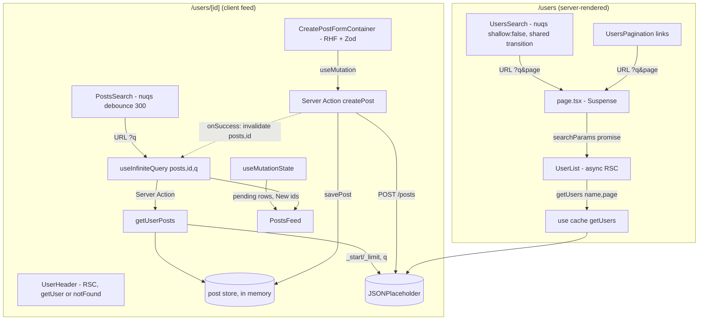
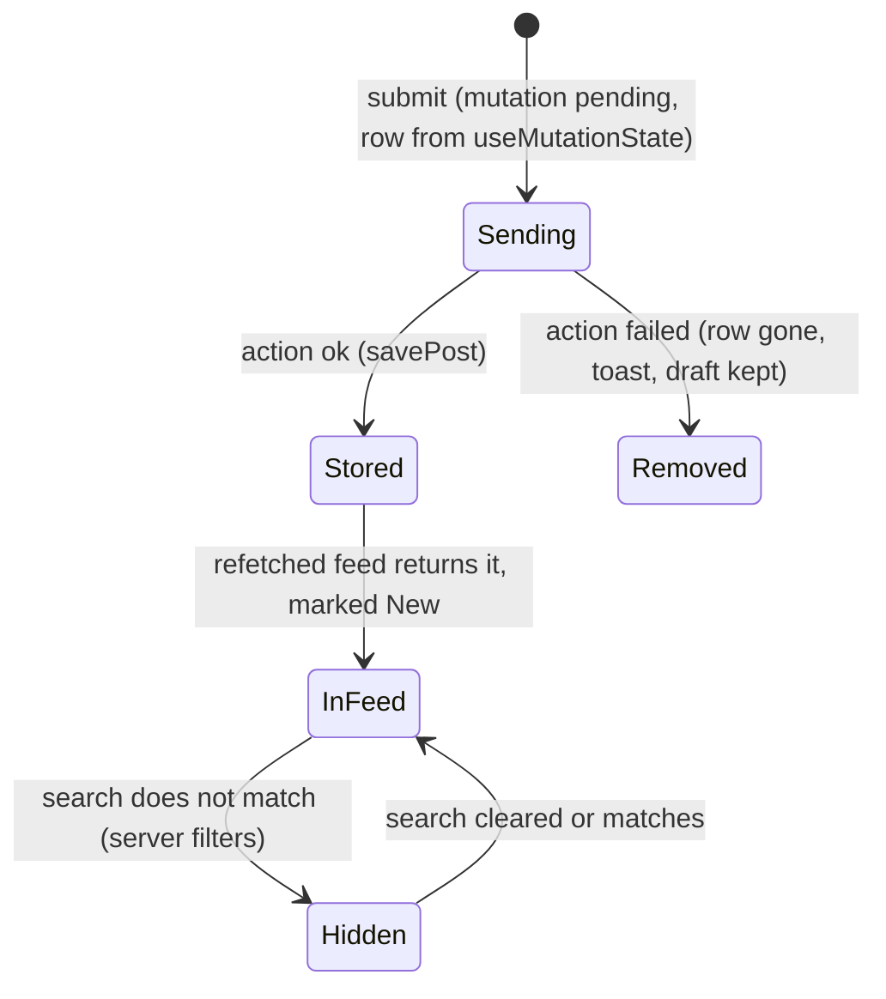

# User Feed Take-Home - Plan

## Goal Capsule

- **Objective:** An evaluator can open a public repo, run the app, search users by name, open a user, scroll through their posts, publish a new post that appears in the list, and see loading and error states. Client components and the server data layer are backed by automated tests, and the server-rendered list is checked manually on a production build. A README explains the decisions, and a commit history shows how the work was built, one unit per commit.
- **Means:** A server-rendered user list driven by URL state (KTD1), and a client-cached infinite posts feed that reads and writes through Server Actions (KTD2), on JSONPlaceholder. The server keeps published posts in memory because the API stores nothing (KTD5).
- **Authority:** `_local_context/task.md` (the brief) wins on product behavior. The Requirements below win over this plan's units. KTDs win on mechanism.
- **Priority order:** Brief requirements first (U1 to U4, then U6). Decoration (U5) is built after the brief is met.
- **Execution profile:** Work happens on a feature branch, never on `main`. Each unit lands as one conventional commit, in unit order (R15), and brings in only what it is the first to need. Delivery is a public GitHub repo within 48 hours of the brief.
- **Stop conditions:** Stop and ask if JSONPlaceholder changes behavior from what is recorded in the API reference below, or if a settled KTD proves unworkable.
- **Who finishes:** The user (repo owner) publishes the repo and sends the link. Playwright e2e lives in a separate worktree and is not part of this plan.

---

## Product Contract

### Summary

Two routes on JSONPlaceholder.

- `/users` is a server-rendered, URL-driven list: 5 users per page, name search, one user card per row.
- `/users/[id]` shows the user header and a client-side infinite feed of their posts, with a search box and a "New post" button that opens the create form in a dialog (a drawer on narrow screens). New posts appear at the top of the feed.

Tests cover the client components and the server data layer. The README records decisions, the API quirks, and how AI was used.

### Problem Frame

The brief is a 48-hour take-home whose functional surface is small: list, search, detail, create. With a surface that small, judgment is the differentiator. Each data strategy must have a reason a reviewer accepts.

- The user list is shareable, bookmarkable state, so it lives in the URL and renders on the server.
- The posts feed is an interactive, growing list, so it lives in a client cache that owns pages, loading and retries.
- JSONPlaceholder accepts a POST but stores nothing. The app keeps published posts in a server-side store and serves them through the same read path as the API's posts, so the client treats the server as the source of truth, as it would with a real API.

JSONPlaceholder has undocumented behavior that a careless build gets wrong: regex filters that return 500, a full-text `q` that matches ids, and a POST that always answers `id: 101`. The plan treats those as requirements.

### Requirements

**User list**

- R1. `/users` lists users 5 per page, with page navigation and a visible total. Previous and Next always render and are disabled at either end, so the layout does not shift. The current page is highlighted.
- R2. A search box filters users by name only, case-insensitive. Any typed character, including regex metacharacters, is safe.
- R3. Search and page live in the URL. A shared or reloaded URL shows the same results. Changing the search returns to page 1.
- R4. An invalid page value falls back to page 1. A page beyond the last page redirects to the last page.
- R5. Each user is a card showing a gradient avatar, name, username, email, phone, city and company, and links to the user's posts.

**User posts**

- R6. `/users/[id]` shows the user's header: avatar, name, username, the company catchphrase, and email, phone and website as links. An unknown or malformed user id shows a not-found page.
- R7. The user's posts load in pages of 4 as the reader scrolls. A "Load more" button does the same for keyboard users and when the observer is unavailable. The end of the list is stated.
- R8. A search box filters the user's posts through the API's `q`. The term lives in the URL without a server round-trip, and changing it restarts the feed from the beginning.

**Create post**

- R9. A form with required title and body validates on the client and on the server. Field errors show inline next to each field. A failure not tied to a field shows in a toast, and the draft is kept.
- R10. Submitting shows the post at the top of the feed immediately, marked "Sending…". Once the server saves it, the feed reloads and the server returns it in place, marked "New". Published posts persist while the server process runs. A failure removes the pending row.
- R11. The form cannot be double-submitted, and each opening starts empty. The dialog does not close on an outside click, cannot close while a post is publishing, and asks before discarding unsaved text. A Cancel button closes it through the same rules.

**States**

- R12. Every data region has a visible loading state, an error state with retry, and an empty state. Empty states differ between "no data" and "no matches". A failed refresh keeps the posts already on screen.
- R13. A progress bar at the top of the page runs while a link navigation is pending. A pending search dims the current results instead.

**Delivery**

- R14. At least 3 Vitest + Testing Library tests pass.
- R15. Commits land incrementally on a feature branch, one per unit.
- R16. The README covers how to run the app, the decisions, the known limits, what would be done with more time, how AI was used (what was asked, accepted and corrected), and the API quirks behind KTD3 and KTD4.

### Acceptance Examples

- AE1. Covers R2. Given the search "an", when results load, then only "Leanne Graham" shows, not users whose email or company contains "an".
- AE2. Covers R2. Given the search "(", when results load, then the empty state shows and no server error occurs.
- AE3. Covers R3, R4. Given `/users?page=2`, when the reader types "cle", then the URL becomes `?q=cle` with no page param, and results show page 1.
- AE4. Covers R4. Given `/users?page=9`, the reader lands on `/users?page=2`. Given `?page=abc`, page 1 renders.
- AE5. Covers R8, R10. Given a published post titled "Hello", when the reader searches "zzz", the post is hidden, because the server filters stored posts with the same `q`. Clearing the search shows it again at the top. A reload keeps it.
- AE6. Covers R8. Given user 1's posts and the search "1", all 10 posts match, because `q` also matches `id` and `userId` by substring. Other users get partial id matches; user 2 gets 9. This is accepted and documented in the README (KTD4).
- AE7. Covers R11. Given a dialog with a typed title, when the reader presses Escape, then "Discard your changes?" asks first. "Keep editing" returns to the draft; "Discard" closes it, and the next opening is empty.
- AE8. Covers R12. Given a loaded feed, when a background refresh fails, then the posts stay on screen and the error shows at the end of the list with a retry.

### Key Decisions

- **Two data strategies, each justified by what the data needs.** Server and URL state for the list, a client cache for the feed (session-settled, user-directed: chosen over a single strategy for both routes, to show range only where each choice has a stated reason). Governs R3, R8, R10.
- **The user list is paginated at 5 per page.** Pagination shows URL state and server rendering even on a 10-user dataset (session-settled, user-directed). Governs R1, R3, R4.
- **The server plays the database for published posts.** The client never keeps or filters its own copy of created posts (session-settled, user-directed: chosen over a client-side created-posts cache, to simulate a real API as closely as possible). Governs R8, R10.
- **New posts show as pending at once and roll back on failure** (session-settled, user-approved). Governs R10.
- **Brief first, decoration later.** The hashed avatar (U5) comes after R1 to R16 are met (session-settled, user-directed). Governs R5.

### Scope Boundaries

- Tests cover client-rendered components and server functions called directly. Async Server Components are covered by Playwright in a separate worktree.
- Real persistence, editing and deleting posts, comments, auth and sorting are out. The API supports `_sort`; the brief does not ask for it.
- Considered and not built: a GET Route Handler for feed reads. Server Actions run one at a time per client, so a feed read waits behind a publish in flight. The README states this trade-off; the session chose one Server Action seam per feature.
- Considered and not built: a newest-wins mutation queue or a server version check. Posts are only created, never edited, so concurrent writes cannot conflict.
- Considered and not built: clamping post search to title and body. `q` matches ids by design (KTD4), and a regex filter cannot express title OR body.

#### Deferred to Follow-Up Work

- Fake post population, so each user's feed has enough posts to feel like a real feed. It plugs into the `getUserPosts` seam (KTD7) without UI changes.
- Playwright e2e for both routes (separate worktree).
- A pagination click within 300 ms of typing in the user search can carry the previous page; the debounced search then resets it.

### API Reference (verified 2026-11-15 by live requests)

JSONPlaceholder runs json-server 0.x. Its guide documents only the basic routes, so these behaviors come from json-server 0.x and were confirmed against the live API.

| Behavior                  | Observed                                                                                                                         |
| ------------------------- | -------------------------------------------------------------------------------------------------------------------------------- |
| `_page`, `_limit`         | Returns `X-Total-Count` and `Link`, exposed to CORS.                                                                             |
| `_start`, `_limit`        | Returns the slice and `X-Total-Count`. `_limit=0` returns `[]` with the total.                                                   |
| Users total               | 10 users, so 2 pages of 5.                                                                                                       |
| Posts                     | Exactly 10 per user, 100 in total. `/users/:id/posts` is equivalent to `/posts?userId=:id`.                                      |
| `name_like`, `title_like` | Case-insensitive regex. An invalid pattern (`(`) returns HTTP 500. Several `_like` params are combined with AND.                 |
| `q`                       | Full-text over every field, including `id` and `userId`. `q=1` on user 1's posts returns all 10, and user 3's returns 1 (id 21). |
| Unknown params            | Ignored.                                                                                                                         |
| Not found                 | `/users/999` returns 404. `/users/999/posts` returns 200 `[]`.                                                                   |
| `POST /posts`             | Nothing is saved. Always responds `{...body, id: 101}`.                                                                          |
| Caching                   | `cache-control: max-age=43200` on reads.                                                                                         |

---

## Planning Contract

### Key Technical Decisions

- KTD1. **Users list: Server Component reading nuqs-parsed search params, fetching through `"use cache"` functions keyed by `(name, page)`.** The search box and the pagination share one transition (`UsersTransitionProvider`), so the list dims (`aria-busy`) while the server renders. The search writes the URL with `shallow: false`, `limitUrlUpdates: debounce(300)` and that transition; clearing applies at once (session-settled, user-directed: chosen over client fetching for the list, for shareable URL state and server rendering). Pattern: `/data/Personal/ecommerce-base/apps/backoffice/src/features/access-management/users/search-params.ts` (`createLoader`, custom positive-page parser, serializer). Under Cache Components, `searchParams` and `params` are passed down as promises and resolved inside components wrapped in `<Suspense>`; parsed values pass as arguments to the cached function, as in `/data/Personal/archived/nextjs-references/next-books/app/page.tsx`. Use `cacheLife("hours")`: the data never changes, and a past-revalidate entry blocks dynamic renders. Every component that calls a nuqs hook sits inside `<Suspense>`, or `pnpm build` fails.
- KTD2. **Posts feed: `useInfiniteQuery` in the browser, calling the `getUserPosts` Server Action.** The query key is `["posts", userId, { q }]` with `q` read from the URL through Next's `useSearchParams()`: `PostsSearch` writes it with nuqs `limitUrlUpdates: debounce(300)`, so the URL, unlike the nuqs state, changes once per pause. Clearing applies at once. The page param is the page number, and `getNextPageParam` reads `nextPage` from the action's result. `placeholderData: keepPreviousData` dims the old rows during a new search instead of flashing the skeleton. Only the user header is server-rendered. Server prefetch plus `HydrationBoundary` is not used: under Cache Components it needs the custom hydration stamp from `next16-team-chat/lib/dehydrate.ts`, which costs more than it gains here. Trade-off: reads queue behind a publish (see Scope Boundaries).
- KTD3. **User search uses `name_like` with the input regex-escaped.** One pure `escapeRegExp` helper is unit-tested (session-settled, user-approved: chosen over `q`, which matches email, company and id and breaks "search by name"; see AE1 and AE2).
- KTD4. **Post search uses `q` for every post, with its id false-positives documented in the README** (session-settled, user-directed: chosen over `title_like`, because it covers title and body and needs no escaping). The post store mirrors json-server's `q`: a case-insensitive substring match on any field, ids included.
- KTD5. **The server keeps published posts in an in-memory store (`post-store.ts`).** `createPost` validates with the shared Zod schema, awaits `POST /posts`, then saves the post with the next id from 101 and returns `{ ok: true, post }`, or `{ ok: false, error }` with an optional `field`. It never throws, because thrown messages are stripped in production. `getUserPosts` serves the user's stored posts first, newest first and filtered by `q`, then pages into the API with `_start`/`_limit`, so every page holds exactly 4 posts across both sources, and the total is the sum. The store is shared by every visitor, lost on restart, and not shared between instances; the README says so.
- KTD6. **Publishing flow: the server is the source of truth.** `useCreatePost` is a `useMutation` keyed `["create-post", userId]`. Its `onSuccess` returns `invalidateQueries(["posts", userId])`, so the mutation stays pending until the refetched feed contains the post, and there is no flicker or duplicate. The feed renders pending posts from `useMutationState` (status `pending`) above the server pages with a "Sending…" badge, and marks posts whose ids come from successful mutations with a "New" badge. No query cache is written by hand.
- KTD7. **One data-access seam per feature, in a `"use server"` module named `server-actions.ts`.** `features/users/server-actions.ts` holds `getUsers` and `getUser` (each `"use cache"` inside). `features/posts/server-actions.ts` holds `getUserPosts` and `createPost`. Both return Zod-parsed data. The UI never builds JSONPlaceholder URLs. `lib/jsonplaceholder.ts` owns the base URL and one `request` helper that times out after 10 seconds and turns network failures, timeouts and non-2xx responses into `ApiError`. `POSTS_PAGE_SIZE = 4` and `USERS_PAGE_SIZE = 5` are named constants in the schemas.
- KTD8. **Errors.** Route-level `error.tsx` uses `retry()`, which became stable in Next 16.3; `reset()` does not refetch Server Component data. Every error renders through one `ErrorState` component (alert plus optional "Try again"). In the feed, a failed first load replaces the feed (`isLoadingError`); any later failure (next page or background refresh) keeps the posts and shows the error at the end of the list, retrying the failed page or refetching. Auto-loading stops while the feed is in error. A failed publish shows `toast.error`; field errors go to the field with `setError`.
- KTD9. **UI from shadcn (`base-luma`, Base UI), installed into `packages/ui` with the shadcn CLI by the unit that first uses each one:** alert, alert-dialog, avatar, badge, button, card, dialog, drawer, empty, field, input-group, pagination, skeleton, sonner, spinner, textarea (plus their dependencies). Toasts use the Sonner wrapper, kept neutral: only the status icon is colored (`text-success`, `text-destructive`), with a `--success` theme token. Forms use field components ported from ecommerce-base into `packages/ui`: `fields/` (`FieldFrame`, `InputField`, `TextareaField`, `SearchField`) and `rhf/` (`Form`, `RhfInput`, `RhfTextarea`). Fields read `control` from the `Form` context and take the values type as a generic (`RhfInput<CreatePostValues>`), which keeps field names type-checked. `SearchField` hides WebKit's own clear button. Never call `watch()`: the `react-hooks/incompatible-library` warning fails lint at max-warnings 0.
- KTD10. **Tests: Vitest with jsdom, `@vitejs/plugin-react` and Testing Library, in `apps/web` only.**
  - `fetch` is stubbed per test with `vi.stubGlobal`. No MSW: one `fetch` call site (`request`) makes a stub enough.
  - Create-post tests run the real Server Actions and post store; only the network is faked. `createPost` is wrapped in a spy that calls through, to count calls. `resetPostStore()` runs before each test.
  - nuqs uses its testing adapter, with assertions on URL updates.
  - `IntersectionObserver` is replaced by a fake class in `tests/support/intersection-observer.ts` that tests can trigger. `matchMedia` is stubbed per test for the dialog/drawer switch.
- KTD11. **Page param:** a custom parser accepts only positive integers and falls back to 1, following the backoffice `positivePage` parser. An out-of-range page `redirect()`s to the last page once the total is known. Zero results render the empty state on page 1. The `[id]` segment is parsed the same way; anything else is `notFound()`.
- KTD12. **Form dialogs.** `ResponsiveDialog` renders a Dialog at 768 px and wider and a Drawer below; the variant is fixed while open, so crossing the breakpoint does not remount the form. Its `disablePointerDismissal` prop keeps a form open on outside clicks. The form container owns its dialog: a close request (✕, Escape, swipe, Cancel) is ignored while submitting, opens `DiscardChangesDialog` when the form is dirty, and closes otherwise. `NewPostButton` gives the container a new `key` per opening, so each opening starts from the default values without `form.reset`. Container and form are split: `CreatePostFormContainer` holds `useForm`, the mutation, toasts and the dialog; `CreatePostForm` only renders fields and buttons, so an edit flow can reuse it.
- KTD13. **Infinite scroll.** `useInfiniteScroll` owns the `IntersectionObserver` (latest `fetchNextPage` via `useEffectEvent`, disconnect on unmount, no-op where unsupported). The "Load more" button is also the observed trigger (`rootMargin: 600px`), auto-loading only when a next page exists, nothing is fetching and the feed is not in error. When a pressed "Load more" loads the last page, focus moves to the end message so it is not lost with the removed button.
- KTD14. **Navigation progress.** A module-level store counts pending link navigations: each `<Link>` that should drive the bar renders `NavigationPendingReporter`, which reports `useLinkStatus().pending`, and `NavigationProgress` shows a 6 px animated bar in the primary color while any is pending (U2). Adapted from ecommerce-base's backoffice. Searches and pagination do not drive it: a bar on every keystroke reads as noise, and the dimmed list (KTD1) is their loading state. `nextjs-toploader` was rejected: it starts on any `<a>` click (pagination included) and cannot follow a nuqs transition.
- KTD15. **Lint:** the shared ESLint base config uses `@typescript-eslint/no-unused-vars` on TS files instead of the core rule, which misreads parameter names inside function types. No `eslint-disable` comments.

### High-Level Technical Design

Data flow across both routes:



Published-post lifecycle (KTD6):



### Output Structure

```text
apps/web/
  app/
    page.tsx                         redirect to /users
    providers.tsx                    NuqsAdapter, NavigationProgress, QueryClientProvider, Toaster
    users/
      page.tsx                       list route
      error.tsx                      ErrorState + retry()
      [id]/
        page.tsx                     header + posts
        not-found.tsx
        error.tsx
  components/
    error-state.tsx
    responsive-dialog.tsx
    discard-changes-dialog.tsx
    navigation-progress.tsx
  hooks/
    use-media-query.ts
    use-infinite-scroll.ts
  lib/
    jsonplaceholder.ts               base URL, request (10 s timeout), apiGet, apiPost, ApiError
    escape-regexp.ts
    query-client.ts
    navigation-progress.ts           pending-links store, reporter
  features/
    users/
      server-actions.ts              getUsers, getUser ("use cache")
      schemas.ts
      search-params.ts               nuqs parsers, loader, href serializer
      utils/                         user-id, initials, avatar-gradient (U5)
      components/                    user-list, user-card, user-header, users-search,
                                     users-pagination, users-transition, user-list-skeleton,
                                     user-avatar (U5)
    posts/
      server-actions.ts              getUserPosts, createPost
      post-store.ts                  in-memory posts, findPosts, savePost, resetPostStore
      schemas.ts                     post + create-post schemas, result types
      search-params.ts
      queries.ts                     postsKeys, postsFeedOptions
      hooks/                         use-posts-feed, use-create-post
      components/                    user-posts, posts-search, posts-feed, post-card,
                                     posts-feed-skeleton, new-post-button,
                                     create-post-form-container, create-post-form
  tests/
    setup.ts
    support/intersection-observer.ts
    *.test.ts(x)
  vitest.config.ts
packages/ui/src/components/
  fields/                            field-frame, input-field, textarea-field, search-field
  rhf/                               form, rhf-input, rhf-textarea, field-state
  *.tsx                              shadcn components (KTD9)
```

---

## Implementation Units

Each unit is one commit, in this order. A unit brings in the dependencies, shadcn components, helpers and tests it is the first to need; later units reuse them and never install ahead of time.

### U1. Users list route (brief point 1)

- **Goal:** `/users` meets R1 to R5 (without the gradient avatar) and R12 for the list, with the test harness and the first tests.
- **Requirements:** R1, R2, R3, R4, R5, R12, R14.
- **Dependencies:** none.
- **Brings in:**
  - Dependencies: `nuqs` (`^2.10.3` or later) and `zod` in `apps/web`; dev dependencies `vitest`, `@vitejs/plugin-react`, `jsdom`, `@testing-library/react`, `@testing-library/user-event`, `@testing-library/jest-dom`; the root `test` script and turbo `test` task.
  - shadcn components (CLI): `alert`, `card`, `empty`, `field` (with `label`, `separator`), `input-group` (with `input`), `pagination`, `skeleton`. `InputGroupTextarea` is removed from `input-group`: the app never uses it, and it would pull in `textarea` before anything needs it.
  - `packages/ui/src/components/fields/`: `FieldFrame`, `InputField`, `SearchField` (KTD9), and the ESLint rule that `FieldFrame`'s function type needs (KTD15).
  - `lib/jsonplaceholder.ts` (`request` with the 10 s timeout, `ApiError`, `apiGet`), `lib/escape-regexp.ts`, `components/error-state.tsx` (KTD8).
  - `app/providers.tsx` with `NuqsAdapter`, wrapped by `layout.tsx`; `app/page.tsx` redirects to `/users`.
- **Files:** `apps/web/features/users/schemas.ts`, `server-actions.ts` (`getUsers`), `search-params.ts`, `utils/initials.ts`, `components/users-transition.tsx`, `users-search.tsx`, `user-list.tsx`, `user-card.tsx`, `users-pagination.tsx`, `user-list-skeleton.tsx`, `apps/web/app/users/page.tsx`, `apps/web/app/users/error.tsx`, `apps/web/vitest.config.ts`, `apps/web/tests/setup.ts`, plus the files listed under Brings in.
- **Approach:**
  1. `search-params.ts` defines `q` and `page` (KTD11), a server loader, and `usersHref` for pagination links.
  2. `getUsers` follows KTD3 and KTD7.
  3. `page.tsx` keeps the shell static, wraps `UsersSearch` and `UserList` in `<Suspense>` inside `UsersTransitionProvider` (a plain `useTransition` for now), and passes the `searchParams` promise to `UserList`.
  4. `UserList` (async RSC) redirects past the last page, shows the total ("10 users", or "2 users match "le""), one card per row, and `Empty` for zero results ("No users match" or "No users").
  5. `UsersSearch` uses `SearchField` with the shared transition (KTD1); typing resets `page`.
  6. `UserCard` is a link card with initials, name, username, and email, phone, city and company with icons. Its target route arrives in U2.
  7. `UsersPagination`: the current page uses the primary variant, and Previous/Next render disabled at either end.
  8. `error.tsx` renders `ErrorState` with `retry()`.
- **Patterns to follow:** ecommerce-base `users/search-params.ts` and `packages/ui/src/components/fields/`; next-books `app/page.tsx` for Suspense placement.
- **Test scenarios:**
  - `escapeRegExp("(a.b)*")` matches only the literal input; `escapeRegExp("")` returns `""`.
  - Covers AE3. Typing "cle" at `?page=2` records a URL update with `q=cle` and no `page`.
  - The search box shows the current search from the URL; clearing it removes `q`.
  - `UserCard` shows who the user is and links to `/users/3` for id 3.
  - Pagination keeps Previous on the first page but disabled, keeps Next on the last page but disabled, and marks the current page.
  - Left to Playwright: the out-of-range redirect (AE4) and regex safety end to end (AE1, AE2).
- **Verification:** On `pnpm build && pnpm start`, AE1 to AE4 behave as written, and a reloaded search URL shows the same results. To reach the error state, cut the machine's network and use a search not yet visited in that server process, since `use cache` serves visited pairs for hours.

### U2. User page and navigation progress

- **Goal:** `/users/[id]` shows the user header (R6), and the top progress bar runs on link navigation (R13).
- **Requirements:** R6, R13.
- **Dependencies:** U1.
- **Brings in:** `lib/navigation-progress.ts`, `components/navigation-progress.tsx` and the bar's animation in `packages/ui/src/styles/globals.css` (KTD14).
- **Files:** `apps/web/features/users/server-actions.ts` (adds `getUser`), `utils/user-id.ts`, `components/user-header.tsx`, `apps/web/app/users/[id]/page.tsx`, `not-found.tsx`, `error.tsx`, `apps/web/app/providers.tsx` (adds `NavigationProgress`), `apps/web/tests/navigation-progress.test.tsx`, plus the files listed under Brings in. Reuses: `user-card.tsx`, `UserHeader`'s back link and `not-found.tsx` render `NavigationPendingReporter` inside their links.
- **Approach:**
  1. The page passes the `params` promise to `UserHeader` inside `<Suspense>`. `resolveUserId` parses the segment or calls `notFound()`; `UserHeader` calls `notFound()` for a missing user. A back link returns to `/users`.
  2. The header shows initials, name, username, the catchphrase, and email (`mailto:`), phone (`tel:`) and website as links.
  3. The bar is fixed to the top of the viewport, 6 px high (`h-1.5`), with a primary-colored segment (`bg-primary`) sliding over a faint primary track (`bg-primary/25`). With `prefers-reduced-motion`, the segment fills the track and does not move.
  4. `error.tsx` and `not-found.tsx` reuse `ErrorState` and `Empty`.
- **Patterns to follow:** ecommerce-base backoffice `lib/navigation-progress`.
- **Test scenarios:** The bar shows while a link navigation is pending and hides after (`useLinkStatus` mocked).
- **Verification:** On the running app, clicking "All users" from a user page shows the bar until the list renders, and typing a search does not show it. `/users/999` and `/users/abc` show not-found.

### U3. Posts feed (brief point 2, part 1)

- **Goal:** The user page shows an infinite, searchable feed with every state (R7, R8, R12).
- **Requirements:** R7, R8, R12, AE6, AE8.
- **Dependencies:** U2.
- **Brings in:**
  - Dependency: `@tanstack/react-query`, with `QueryClientProvider` in `providers.tsx` and `lib/query-client.ts` (one browser client, 60 s `staleTime`, no refetch on window focus).
  - shadcn component: `spinner`.
  - Hook: `use-infinite-scroll.ts` (KTD13), with `tests/support/intersection-observer.ts`, and `tests/support/search-params.ts` (a stand-in URL the nuqs testing adapter writes and the `next/navigation` mock reads).
- **Files:** `apps/web/features/posts/schemas.ts` (post, `POSTS_PAGE_SIZE`, page and result types), `server-actions.ts` (`getUserPosts`), `search-params.ts`, `queries.ts`, `hooks/use-posts-feed.ts`, `components/user-posts.tsx`, `posts-search.tsx`, `posts-feed.tsx`, `post-card.tsx`, `posts-feed-skeleton.tsx`, `apps/web/app/users/[id]/page.tsx` (adds `UserPosts`), `apps/web/tests/posts-feed.test.tsx`, `use-infinite-scroll.test.tsx`, `posts-server-actions.test.ts`, plus the files listed under Brings in. Reuses: `SearchField`, `ErrorState`, `Empty`, `Skeleton`.
- **Approach:**
  1. `getUserPosts` pages the API with `_start`/`_limit` and `q` (KTD4, KTD7); the post store arrives in U4.
  2. `UserPosts` renders the "Posts" heading, the search and the feed.
  3. `PostsSearch` writes `q` with nuqs, debounced 300 ms while typing. `usePostsFeed(userId)` reads `q` from the URL, runs the infinite query (KTD2), and returns `{ feed, search, posts }`.
  4. `PostsFeed` only renders: skeleton on first load, `ErrorState` per KTD8, `Empty` ("No posts match" or "No posts yet"), the posts, and a footer from early returns: the "Load more" trigger (KTD13) or "You've reached the end" in a polite live region.
- **Patterns to follow:** `/data/Personal/archived/nextjs-references/next16-social-media/components/ui/load-more.tsx` for the button's pending label.
- **Test scenarios:**
  - `getUserPosts` gives `nextPage: 2` for a full first page of 10, and no next page on the last page; it sends `userId`, `q`, `_start` and `_limit=4`, and omits `q` when blank; a 500 resolves to `{ ok: false }`; a timeout returns "The server took too long to answer. Try again."
  - `useInfiniteScroll` loads the next page when the trigger nears the viewport (600 px), does not watch while a page loads, after a failure or on the last page, calls the latest query without re-observing, stops watching on unmount, and does nothing where `IntersectionObserver` is missing.
  - Typing sends one search after a pause, and clearing goes back to the unfiltered feed.
  - The first page shows after the skeleton; Load more continues until the end message, which takes focus.
  - A failed first load shows the error, and Try again recovers.
  - A failed later page keeps the loaded posts and offers Try again.
  - Covers AE8. A failed background refresh keeps the posts and shows the error; Try again recovers.
  - Empty states for "no matches" (and the URL carries `q`) and "no posts".
  - The next page loads by itself when Load more scrolls into view.
  - Typing in the search after an earlier Load more keeps focus in the search box.
- **Verification:** On the running app, scrolling loads 4 + 4 + 2 = 10 posts. With DevTools offline, the feed's Server Action fails and the error states are reachable. Typing in the post search updates the URL without an RSC request.

### U4. Create post (brief point 2, part 2)

- **Goal:** A validated form in a guarded dialog publishes a post that the server stores and the feed shows at the top (R9 to R11).
- **Requirements:** R9, R10, R11, AE5, AE7.
- **Dependencies:** U3.
- **Brings in:**
  - Dependencies: `react-hook-form` and `@hookform/resolvers` in `apps/web`, and `react-hook-form` and `sonner` in `packages/ui`.
  - shadcn components: `alert-dialog`, `badge`, `dialog`, `drawer`, `textarea` (for `TextareaField`), `sonner` (neutral toasts, colored icons, with the `--success` tokens in `globals.css`), and the `Toaster` in `providers.tsx`.
  - `packages/ui/src/components/fields/textarea-field.tsx` and `rhf/` (`Form`, `RhfInput`, `RhfTextarea`, field props).
  - `components/responsive-dialog.tsx`, `components/discard-changes-dialog.tsx`, `hooks/use-media-query.ts` (KTD12), `apiPost` in `lib/jsonplaceholder.ts`, and `postsKeys.all` in `queries.ts` (the key the mutation invalidates; `feed` is built from it).
- **Files:** `apps/web/features/posts/post-store.ts`, `schemas.ts` (create schema and result), `server-actions.ts` (`createPost`; `getUserPosts` serves stored posts first), `hooks/use-create-post.ts`, `hooks/use-posts-feed.ts` (pending rows, New ids), `components/new-post-button.tsx`, `create-post-form-container.tsx`, `create-post-form.tsx`, `posts-feed.tsx` (badges), `user-posts.tsx` (button in the heading row), `apps/web/tests/create-post-form.test.tsx`, `posts-server-actions.test.ts` (store and create cases), plus the files listed under Brings in.
- **Approach:**
  1. The create schema trims title and body and requires both ("Title is required", "Body is required"), with caps of 120 and 2000 characters. The same schema runs in the resolver and in the action.
  2. `post-store.ts`, `createPost` and the merged `getUserPosts` follow KTD4 and KTD5.
  3. `useCreatePost` follows KTD6. `usePostsFeed` also returns `publishing` and `newPostIds`.
  4. `CreatePostFormContainer` follows KTD12: on a field error, `setError`; on any other error, `toast.error("We could not publish the post")` with the reason; on success, close and `toast.success("Post created successfully")`.
  5. `CreatePostForm` renders `RhfInput`/`RhfTextarea`, Cancel, and Publish with a paper-plane icon after the label (a spinner while publishing). The `Form` fieldset disables everything while submitting.
- **Patterns to follow:** `/data/Personal/ecommerce-base/apps/backoffice/src/features/access-management/users/form/user-form.tsx` and `user-form-dialog.tsx`; ecommerce-base `packages/ui/src/components/rhf/`.
- **Test scenarios** (real actions and store, `fetch` stubbed):
  - Stored posts come first, newest first, and pages continue into the API's posts (3 stored plus 5 from the API: page 1 is the 3 stored and API post 1, page 2 is API posts 2 to 5, total 8); they are filtered by `q` and belong only to their author.
  - `createPost` trims, posts the values, hands out increasing ids, rejects an empty field without calling the API, and reports a failed API call.
  - Empty and whitespace-only fields show both required messages, and the action is not called.
  - A valid submit shows the post at the top with "Sending…" before the server answers; afterwards the row comes from the server's feed marked "New", the success toast shows, and the dialog closes.
  - Two posts appear newest first above the existing post.
  - Covers AE5. The server filters new posts with the search, and clearing it shows them again.
  - A rejected POST keeps the draft, removes the pending row, and shows the toast with the reason.
  - Clicking Publish twice sends one post.
  - On a narrow screen the form opens in a drawer; crossing the breakpoint while open keeps the draft.
  - Cancel closes at once when nothing was written.
  - Covers AE7. A dirty form asks before discarding; Keep editing keeps the draft; Discard closes, and the next opening is empty.
  - The dialog stays open while publishing, so a failure is never missed.
- **Verification:** On the running app, a published post survives a reload and appears for other browser sessions; an outside click does not close the dialog or the drawer.

### U5. Hashed avatar decoration

- **Goal:** User cards and the header get a deterministic gradient avatar derived from the user's email.
- **Requirements:** R5, R6.
- **Dependencies:** U1, U2.
- **Brings in:** the shadcn `avatar` component and `features/users/utils/avatar-gradient.ts`.
- **Files:** `apps/web/features/users/components/user-avatar.tsx`, `user-card.tsx`, `user-header.tsx`, `apps/web/tests/user-avatar.test.tsx`, plus the files listed under Brings in.
- **Approach:** Adapt `hashStringToInt` and the `seedToGradient` approach (hue h1 from a 31-multiplier hash, h2 = h1 + 35, `linear-gradient(135deg, ...)` at 42% and 34% lightness so white initials stay readable) onto the shadcn `Avatar` fallback, with two initials. It replaces the plain initials in the card and the header.
- **Patterns to follow:** `/data/Avangenio/Projects/Projects/bd-contratacion/packages/ui/src/lib/hash.ts` and `apps/web/src/components/ui/user-avatar.tsx`.
- **Test scenarios:** The same seed always yields the same hue; different seeds spread over different hues; the hue stays within 0 to 359 for any input; the avatar paints the initials on the gradient that belongs to the email.
- **Verification:** The 10 users show stable, distinct gradients across reloads.

### U6. README

- **Goal:** R16 is met with content an evaluator can act on.
- **Requirements:** R16.
- **Dependencies:** U1 to U5.
- **Files:** `README.md` (replaces the shadcn template text).
- **Approach:** Sections:
  - How to run: Node version from `.nvmrc`, pnpm, dev, test and build commands.
  - Architecture and the two strategies with their reasons (KTD1, KTD2, Key Decisions).
  - API quirks: the API reference table, with KTD3, KTD4 and the `id: 101` handling.
  - Known limits: the in-memory post store (shared, lost on restart, per instance), feed reads queuing behind a publish (Server Actions), `q` false positives, the pagination click during the search debounce, CSR-only component tests.
  - With more time: fake population, Playwright, sorting, server prefetch with hydration, a GET Route Handler for reads.
  - How AI was used: what was asked, accepted and corrected. Examples: the `bd-comparacion` vs `bd-contratacion` correction, rejecting `q` for users, moving created posts from a client cache to a server store, and the focus and refetch-error bugs caught by tests.
  - Time spent.
- **Test scenarios:** Test expectation: none. This is documentation.
- **Verification:** A fresh clone following only the README runs the app and the tests.

---

## Verification Contract

| Gate                     | Command                                                          | Applies                                                                                   |
| ------------------------ | ---------------------------------------------------------------- | ----------------------------------------------------------------------------------------- |
| Unit and component tests | `pnpm test` (turbo → `apps/web` Vitest)                          | Every unit                                                                                |
| Types                    | `pnpm typecheck`                                                 | Every unit                                                                                |
| Lint                     | `pnpm lint` (max-warnings 0)                                     | Every unit                                                                                |
| Production build         | `pnpm build`                                                     | Every unit. It catches Cache Components errors such as an uncached read outside Suspense. |
| Commit hooks             | husky pre-commit (lint-staged) and commitlint run on each commit | Every commit                                                                              |

Manual checks run on `pnpm build && pnpm start`, not dev, because cache timing differs: AE1 to AE8, the U3 network check, and the error states as each unit's Verification describes (the server-side list needs the machine's network cut; the feed's Server Action fails with DevTools offline).

---

## Definition of Done

- R1 to R16 hold. AE1 to AE5, AE7 and AE8 pass manually, and AE6 is documented.
- The test suite passes: 10 test files across U1 to U5.
- `pnpm build`, `pnpm typecheck` and `pnpm lint` are clean, with no `eslint-disable` comments.
- Each unit is its own conventional commit on the feature branch, in unit order.
- No dead code from abandoned approaches, and no unused shadcn components left installed.
- The README is complete per U6, including the time spent.
